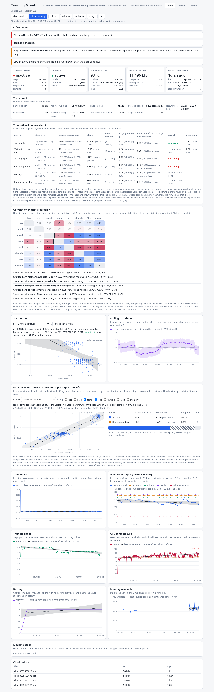

# nn-dashboard

A small, offline, read-only training-statistics dashboard (Python standard library only) with paired-device login, so a phone app can read it over a private network.
It reads training logs, checkpoints and systemd status from directories you configure, and never writes to them or controls any service.

**Documentation:** [version history with screenshots](docs/VERSION_HISTORY.md) · [what we learned](docs/LEARNINGS.md) · [results](docs/RESULTS.md)

## Run

    python3 -B server.py            # serves on 127.0.0.1:8765

| variable | default | meaning |
|---|---|---|
| `NN_DATA` | `~/nn_data` | training data dir (`logs/`, `ckpt/`, `labels/`) |
| `NN_WORK` | `~/nn_overnight` | sampler/watchdog output dir |
| `NN_DASH_CONFIG` | `~/.config/nn-dashboard` | holds `pair.secret`, `devices.json`, `pairing.json` |
| `NN_DASH_PORT` / `NN_DASH_BIND` | `8765` / `127.0.0.1` | listen address |
| `NN_TRAIN_UNIT` | `nn-train.service` | systemd user unit shown as the trainer |
| `NN_RUNS` | unset | `dir=unit;dir=unit`: follow whichever run is active (newest first) |
| `NN_DASH_NOAUTH=1` | off | browser use without login; honoured **only** on loopback |

Do not expose the dashboard to the internet. Reach it through a private network (Tailscale, WireGuard, SSH tunnel). Over plain HTTP a session token can be sniffed, so use a private tunnel or TLS.

## Pairing and login (auth.py)

> **Experimental and unaudited.** This auth code is home-made, has had no independent security review, and has no TLS of its own. Use it only behind a private network (Tailscale, WireGuard, SSH tunnel) and treat it as a convenience gate, not a hardened login.

1. First run creates a 32-byte master key `pair.secret` (mode 0600 in a 0700 directory, `O_EXCL`). The server refuses to start if the file has the wrong mode, length or is all zeros.
2. `python3 -B server.py --pair` on the machine prints a single-use pairing token (128 bits, 5-minute expiry; only its hash is stored).
3. The phone POSTs `{"token": ...}` to `/auth/redeem` and receives its own device key, shown once. The master key never leaves the machine.
4. Login: `GET /auth/challenge` returns a fresh 16-byte nonce; the phone POSTs `{device_id, nonce, response}` to `/auth/login` with `response = HMAC-SHA256(device_key, nonce)` and gets a 1-hour session token, sent as `Authorization: Bearer ...` to `/api/stats`.
5. Nonces are single use, comparisons are constant-time, failures are rate-limited per client (5 per minute). Revoke a phone by deleting its id from `devices.json`.

**Randomness:** every secret comes from Python's `secrets` module (the operating system's `getrandom`, a CSPRNG seeded from hardware entropy). There is no use of the `random` module, `RDRAND` or custom entropy mixing. This is a deliberate choice for a status page, not a one-time pad: there is no finite key to exhaust. Anyone who wants to supply their own key (for example from dice) can place a 32-byte file at `pair.secret`.

The repository contains no key, token or default password; each install generates its own on first run.

## Tests

    python3 -B -m unittest discover -s tests

## License

MIT
