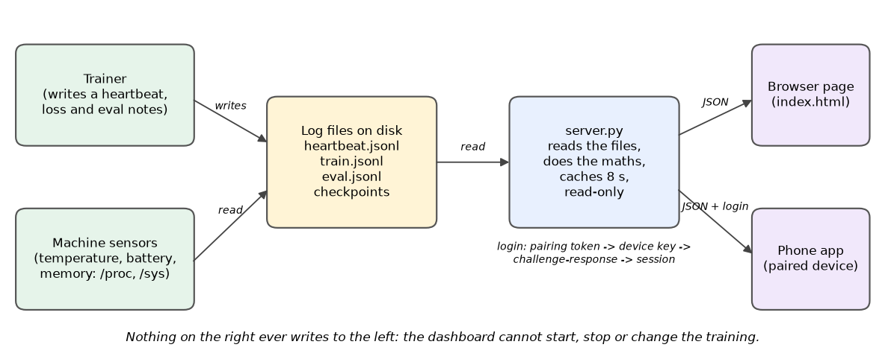

# How it works

The dashboard is one small Python file (`server.py`, standard library only) and one web page (`index.html`). It never writes to the training data and never controls the trainer: it only reads files and system information and turns them into charts.

## What it reads
| source | what it holds | used for |
|---|---|---|
| `logs/heartbeat.jsonl` | one line a minute: time, battery, AC power, CPU temperature, load, step, "training" flag | status lights, speed, stops (a gap of more than 3 minutes counts as a stop) |
| `logs/train.jsonl` | step, loss, gradient size, learning rate | the loss chart and training trends |
| `logs/eval.jsonl` | validation scores for the model and the baselines (random, strided, heuristic) | the validation-regret chart |
| `ckpt/ckpt_*.npz`, `best.npz`, `best_meta.json` | saved copies of the model | "latest checkpoint", checkpoint list |
| `config.json` | run configuration (for example whether geometric features are on) | a warning if the model's inputs are empty |
| `samples.tsv` (optional) | a 5-minute sampler: free memory, swap, temperature, throttle counter, clock speed | the memory chart and throttling warnings |
| `/proc`, `/sys`, `systemctl --user show` | live machine and service state | "now" cards |

`demo/make_demo_data.py` writes all of these with synthetic numbers, so you can try the dashboard with no real run.

## What it serves
| route | answer |
|---|---|
| `GET /` | the page (only when running with `NN_DASH_NOAUTH=1` on loopback) |
| `GET /api/stats?range=...` | the statistics as JSON. `range` is `live`, `1h`, `6h`, `24h`, `7d`, `all` or `run` (since the last stop). Needs a session token unless auth is off. |
| `GET /auth/challenge`, `POST /auth/redeem`, `POST /auth/login` | the paired-device login (see [SECURITY](../SECURITY.md)) |

Results are cached for 8 seconds, so many open tabs cost almost nothing.

## Following the right run
Training runs live in different directories. If `NN_RUNS="dir=unit;dir=unit"` is set, the server picks the run whose trainer unit is active (otherwise the one with the freshest heartbeat), and tells you which one in the "Trainer" card. Before this existed, the page happily reported a stopped older run while a new one was healthy: see [LEARNINGS](LEARNINGS.md).

## Where the maths happens
The server aligns everything on a common time grid and does the summaries. The page (in JavaScript) fits the trend lines, correlations, regressions and bands from the points it receives, so the formulas are in `index.html`. The statistical choices (autocorrelation-adjusted intervals, effective sample size, out-of-sample R-squared) are explained in [How to read the charts](HOW_TO_READ_THE_CHARTS.md).

## Staying up
The page retries every 5 seconds if the server disappears and refreshes when you return to the tab. The provided `nn-dashboard.service` restarts the server if it exits.

# The website's pages

Everything below runs in the visitor's browser. The only thing that ever leaves a device is a volunteer's results (see [lending computer time](CONTRIBUTE_COMPUTE.md)).

## Watching the bot (`web/play/`)
One turn, in order: `driver.js` reads the settled board from the running game, asks the bot worker for an aim, taps it, waits for the balls, and logs what happened.

| file | its one job |
|---|---|
| `best/worker.js` | answers "which aim?"; shares the work among helpers when allowed |
| `best/search.js` | the choosing rule, written as a plan that asks for batches of shots, so one processor or several give the same choice |
| `best/sim.js` | one shot, simulated with the game's own physics library and the game's event rules |
| `best/features.js` | the learned scorer that ranks all 781 aims |
| `best/pool.js`, `best/simworker.js` | helper workers that simulate shots |
| `driver.js` | the play loop, the log (kept on the device) and the page's controls |
| `clock.js` | runs inside the game: more fixed frames per screen refresh while shots fly, never a stretched frame |
| `thought.js` | the see-through display of what the bot is testing, with rings on blocks about to reach the line |
| `hud.js` | scoreboard, danger meter, records, milestones |
| `stats.js` | the statistics (no page needed, so they are tested directly) |
| `analysis.js`, `explore.js`, `system.js` | the accuracy panel, the exploring tools and the machine readings |
| `record.json` | the record game, turn by turn |
| `scene.js` | the "Build a puzzle" panel: checks a scene, fills in what was left empty (nothing entered is changed; several numbers use their average), and makes the game build it |
| `progression.json` | how a real game progresses, measured from logs of real games; written by `tools/fit_progression.py` and checked against the game's rules in [GAME_RULES.md](GAME_RULES.md) |

## The choosing rule, in stages
1. Test the most promising spread-out shots (16 when nothing is near the line, otherwise 30).
2. If every one loses, test the rest until one survives.
3. If a block would be last-chance next turn and no shot breaks it, test shots aimed at it.
4. If there is an extra ball and no shot collects it, test shots aimed at it.
5. Play the best tested shot: survive, then low blocks, then the ball, then damage.

What each stage guarantees, and what it does not: [bot guarantees](math/BOT_GUARANTEES.md).

## Lending computer time (`web/contribute/`)
`contribute.js` runs the consent box and the sending; `power.js` turns the slider and safety switches into a number of workers; `outbox.js` packs messages; `monitor.js` draws "Your device"; `worker.js` and `tasks.js` simulate the work.
