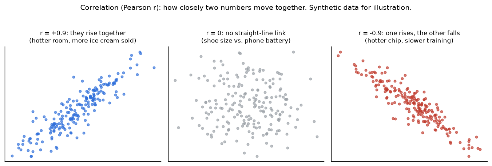
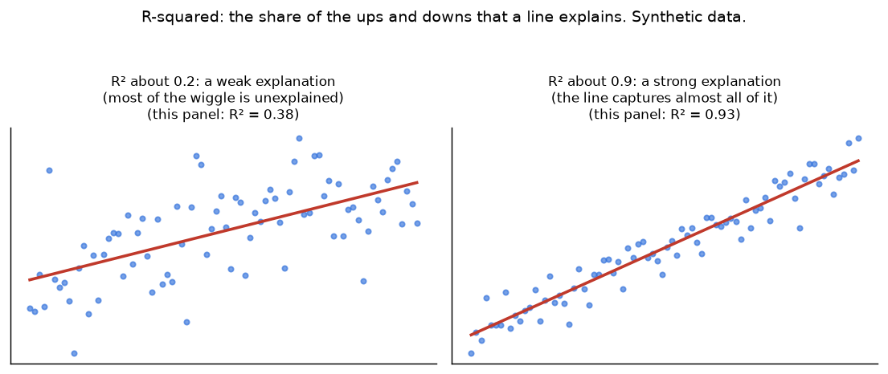
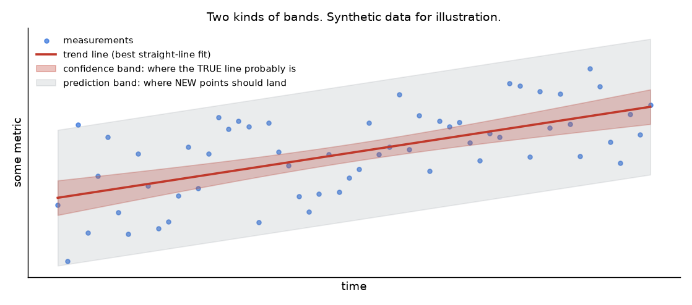

# How to read the dashboard

No statistics background needed. Each section of the page, in the order you meet it. (The [guided tour](PLAIN_ENGLISH.md) shows where everything is.)

## The status cards
- **Trainer**: is it running, which step it is on, how fast (steps per minute), and how many times it restarted.
- **Machine**: temperature, clock speed, load and power. A hot chip slows itself down ("throttling"), which is why the page warns you.
- **Latest checkpoint**: how old the last saved copy is. A big number here with a "running" trainer means something is wrong.
- **Stops ever seen**: how many times the heartbeat went quiet for more than three minutes.

## The charts
- **Training loss** is the model's error on the examples it learns from. Down is good. A line that goes flat does *not* prove the model stopped learning: part of the loss can never go away (it is a floor), so look at the next chart too.
- **Validation regret** is the honest report card: how much damage the model gives up on games it was never trained on. Lower is better. The dashed lines are baselines (random, evenly spaced aims, a simple rule). If the model's line is not clearly below them, it is not adding much. This chart is noisy because it uses only 4 games.
- **Training speed** and **CPU temperature**: when the temperature climbs, speed usually drops. The red line at 100 degrees is the danger mark.
- **Battery** and **Memory**: a battery line that falls while nothing is training means the machine was asleep or off.
- **Machine stops**: every time it went quiet, for how long, and what the battery and temperature were just before.

## The trend table
For each metric the page draws the best straight line through the points and tells you:
- **slope**: how fast it is going up or down, with a 95% interval ("the true slope is probably in here");
- **verdict**: "improving", "worsening" or "no detectable trend". That last one means the interval includes zero, not that nothing is happening;
- **R-squared**: how much of the wiggle the line explains (see below);
- **calibration**: how many points really fall inside the prediction band. If it is far below 95%, the band is too narrow for this data and you should trust it less.

Points that are neighbours in time resemble each other, which makes naive error bars far too confident. The page widens its intervals to account for that.

## Correlation

Each cell of the matrix is a number between -1 and +1. Blue means the two things rise together, red means one rises as the other falls, and pale cells are not statistically significant. Careful: two things that both drift over time can look related even when they are not. The "detrended" and "changes" modes remove the drift so you can check.

## R-squared

"R² = 0.9" reads as "other measurements account for about 90% of the ups and downs". The page also shows an **out-of-sample** R-squared: it fits on some stretches of time and predicts others it never saw. That is the honest number, and it can even be negative. **Unique R²** says how much a metric adds on its own, and **VIF** warns when two metrics are basically the same thing.

## The two kinds of bands

The narrow band says where the *true line* probably is. The wide band says where *new measurements* should land. They answer different questions, which is why the wide one is so much wider.

## A word of caution
Association is not cause. Load and speed move together in our data because the trainer's own work is part of the load. The page says so, and so should you.
