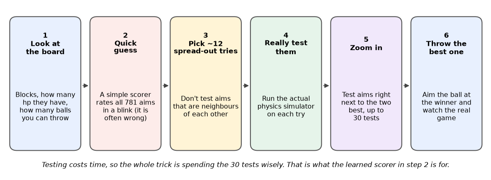
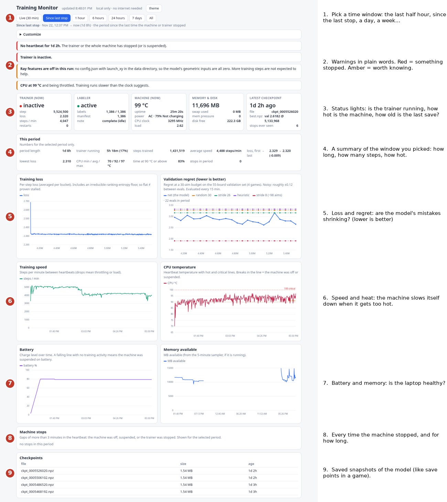

# In plain English

*No software background needed. If a word looks scary, it is in the [glossary](#glossary) below.*

## The 60-second version
There is a puzzle game where you aim a ball and throw it at a stack of blocks that keeps creeping toward you. You lose if the blocks reach the bottom. There are **781 different ways to aim**, and a good player picks the aim that smashes the most blocks.

We taught a computer program to pick the aim. Training a program like that takes hours, even days, on an ordinary laptop, and the laptop has to keep running the whole time. So we built a **dashboard**: a web page, running only on the laptop itself with no internet needed, that shows how the training is going, how hot the machine is, and whether anything stopped.

This repository is that dashboard, plus the notes from what we learned along the way.

## An analogy: the pinball player
Imagine a pinball player who is allowed to *practise 30 shots in a mirror universe* before each real shot. The mirror universe (the **simulator**) behaves like the real table, but each practice shot takes real time, so you cannot practise all 781 shots.

- A **bad player** tries 30 random shots.
- A **careful player** tries evenly spaced shots, then zooms in near the best one. (That is our baseline, "coarse-to-fine".)
- Our **scorer** is a hunch: a quick guess about which shots look promising, learned from thousands of past boards. The player uses the hunch to choose *which* 30 shots to practise.

The result: with the hunch, the player loses less damage than the careful player when practice time is short. About as good with **30 practice shots as the careful player with about 50**. With 100 practice shots there was no real difference.

## A guided tour of the dashboard

## What did we actually find? (the honest version)
- **The hunch helps a bit, mostly when time is tight.** It is roughly a one-and-a-half-times saving, not a miracle. We measured it on 16 games the program had never seen. It won on 14 of them at 30 practice shots.
- **The fancy part of the AI (a neural network) just memorised.** Instead of learning the *idea* of a good shot, it learned the answers to the boards it had seen, like a student who memorises last year's exam. A much simpler method did about as well, so the simple method is what we use.
- **More data did not help the simple method.** Using 15 games or 60 games gave about the same score, so the limit is what information we give it, not how much.
- **The practice universe is not perfect.** With one ball it matched the real game almost every time (95%). With three balls it matched only about 63% of the time. Balls bouncing off balls is chaotic.
- **We were wrong about some things, and we said so.** Several early guesses were corrected; the [learnings](LEARNINGS.md) page lists them.
- **We never figured out why the laptop kept switching itself off.** We have clues (heat, a worn-out battery) but not proof.

## What this is *not*
- It is not a finished product or a world-beating game bot. Most numbers come from a simulator and a small number of games.
- The login code is home-made and has not been reviewed by a security expert. Do not trust it with anything important.
- It does not control the training. It only watches and draws charts.

## Glossary
| word | what it means here |
|---|---|
| **aim** | One of 781 possible directions to throw the ball. |
| **board** | One snapshot of the game: where the blocks are, how tough each is, how many balls you have. |
| **hp** | "Hit points": how many hits a block can take. Damage is measured in hp removed. |
| **simulator** | A copy of the game's physics that can be run quickly and as many times as we like, without playing the real game. |
| **scorer** | A quick guess, learned from past boards, about which aims look promising. |
| **regret** | How much damage we gave up compared with the best possible aim. Lower is better; zero means we found the best one. |
| **training** | Showing the program thousands of boards so it improves its guesses. |
| **neural network** | A kind of program loosely inspired by brains; very flexible, which is also why it can memorise. |
| **linear / ridge model** | A much simpler kind of guesser: a weighted sum of features, like a recipe. |
| **memorising (overfitting)** | Doing great on boards it has seen and poorly on new ones. |
| **validation / held-out games** | Games kept out of training so we can check honestly whether it works on new ones. |
| **sealed test set** | A final exam we never opened, so nobody (including us) can peek and tune to it. |
| **checkpoint** | A saved copy of the program's progress, so a crash costs minutes, not hours. |
| **CPU / throttling** | The laptop's brain. When it gets too hot it slows itself down to protect itself. |
| **correlation** | How strongly two numbers move together (+1 together, -1 opposite, 0 unrelated). It does not prove one causes the other. |
| **R-squared (R²)** | The share of one number's ups and downs that other numbers explain. 0.9 = 90%. |
| **confidence interval / band** | A range that says "the true value is probably in here"; wider means less certain. |
| **bootstrap** | Re-running an analysis on randomly re-drawn copies of the data to see how much the answer wobbles. |
| **heartbeat** | A tiny note the trainer writes every minute, saying "still alive". No notes for a while means it stopped. |
| **dashboard** | A page of charts and status lights you can read at a glance. |
| **token / login** | A secret password-like string that proves a phone is allowed to look at the dashboard. |

## Pop-culture decoder
A few things in this project are easier to remember with a reference.

- **Save points are bonfires.** A *checkpoint* is a Dark Souls bonfire: die (crash) and you respawn there, not at the start. Our trainer lights a new bonfire every two minutes tonight.
- **The sealed test set is Severance.** The "innie" (our analysis) never sees the outside world (the test games), so it cannot cheat. Management (us) promised not to open the door.
- **Memorising is Groundhog Day.** The neural network relived the same 896 boards until it knew every line. Impressive, but Phil only became a better person when the day *changed*.
- **Checkpoints are also Memento.** The trainer forgets everything when it stops, and gets by on notes it left itself, with the sensible difference that ours are not tattooed on anyone.
- **The overheating CPU is an Allomancer burning pewter.** Great output, but burn at full tilt for too long and you crash. The thermal guard is the friend who says "that's enough for tonight". (A *Mistborn* reference: pewter gives you strength, but not for free.)
- **The simulator is the Matrix, with a catch.** It is convincing and fast, but with three balls it is wrong about one time in three. "There is no spoon" works until the balls start colliding.
- **"Is the metric the goal?" is Goodhart's law.** We score by *regret*, but regret is a stand-in for winning the game. When a measure becomes the target, it stops being a good measure, so live games are the final test.
- **Running a live game at 98 degrees is a Jurassic Park moment.** We could, and then we had to think about whether we should. We added a cap and a guard.
