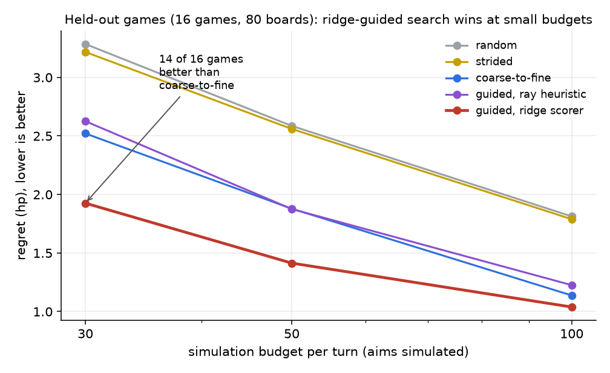
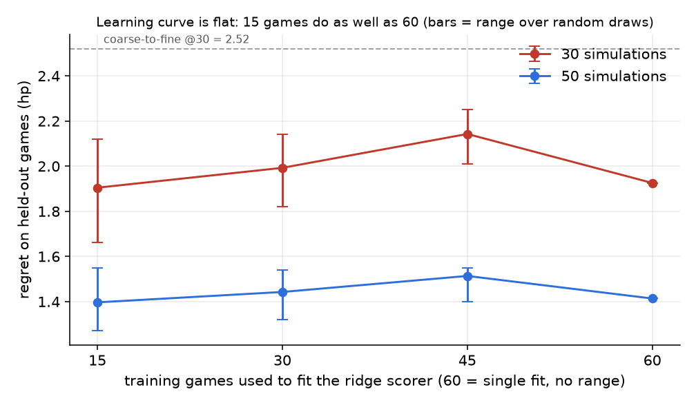

# Results (simulator-measured regret, lower is better)

Regret = best hp over all 781 candidate aims minus the best hp among the aims a method simulated. "Dev" = 16 held-out games, 80 boards, all 781 aims labelled; settings were frozen on the 4 validation games before dev was scored. Mean best hp per dev board: 11.95.

| simulations | random | strided | coarse-to-fine | guided, ray heuristic | guided, ridge | ridge minus coarse-to-fine (paired, 95% game bootstrap) | games ridge better |
|---|---|---|---|---|---|---|---|
| 30 | 3.284 | 3.216 | 2.520 | 2.625 | **1.925** | -0.595 [-0.92, -0.31] | 14 of 16 (sign test p = 0.004) |
| 50 | 2.585 | 2.559 | 1.878 | 1.875 | **1.413** | -0.466 [-0.76, -0.19] | 12 of 16 (p = 0.077) |
| 100 | 1.812 | 1.788 | 1.137 | 1.225 | 1.038 | -0.100 [-0.32, +0.11] | 8 of 16 (p = 1.0) |

Pooled over 20 games (val + dev): ridge minus coarse-to-fine is -0.654 [-0.97, -0.35] at 30 simulations, -0.517 [-0.76, -0.28] at 50 and -0.116 [-0.32, +0.07] at 100. Zero-regret boards on dev (of 80): ridge 25 / 30 / 40 at 30 / 50 / 100 simulations, coarse-to-fine 10 / 10 / 13.

## Learning curve

| training games | regret at 30 sims (mean of 6 draws; 60 = one fit) | range |
|---|---|---|
| 15 | 1.904 | 1.66 - 2.12 |
| 30 | 1.992 | 1.82 - 2.14 |
| 45 | 2.142 | 2.01 - 2.25 |
| 60 | 1.925 | single fit |

## Other measurements
- Ablation (5-fold leave-games-out on 60 training games, regret at 10 of about 98 labelled aims): 40 features 2.973; without the 11 board scalars 2.973; with interactions 2.748 (difference -0.225 [-0.49, +0.03], not adopted by the pre-written rule).
- Shortlist headroom on dev: exact best aim in the top 50 on 25% of boards for ridge, 38% for the ray heuristic, 16% for random.
- Survival: within-board Spearman between damage and margin-to-loss +0.395 on average; a margin model reached +0.445 on held-out games (damage scores alone: +0.231); the "board cleared" flag had an AUC of 0.711 with only 91 positives.

## Caveats
Sixteen or twenty games give wide intervals; "50 simulations" is likely rather than settled; dev has been used once to select a model and is now spent for that purpose. Simulator fidelity falls with ball count (94.9% / 80.0% / 62.5% exact for 1 / 2 / 3 balls), and real-game play is the final test.
