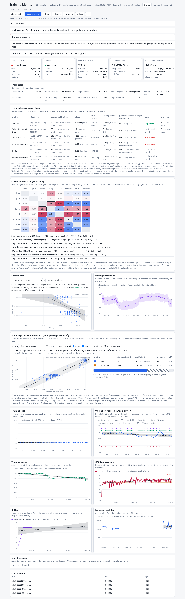

# Dashboard version history

The dashboard grew in small steps over roughly ten days (November 2026). Each version below is the real page, captured from the archived page of that version, against the same older run (about 9 days of training logs) so they are directly comparable. The alert banners at the top ("no heartbeat", "trainer is inactive", ...) are accurate for that older run, which had been stopped.

| version | what it added | screenshot |
|---|---|---|
| **v1** | Offline, read-only, local-only page. Summary cards (trainer, labeler, machine, memory and disk, latest checkpoint); time ranges (live 30 min, since last stop, 1 h, 6 h, 24 h, 7 d, all); a Customize panel; six time-series charts (training loss, validation regret against baselines, training speed, CPU temperature, battery, memory available); a table of machine stops; the checkpoint list; alert banners (no heartbeat, trainer inactive, throttling). | [image](images/dashboard_v1.png) |
| **v2** | Trends: an ordinary least-squares line for each metric, with slope, a 95% interval widened for lag-1 autocorrelation, adjusted R-squared, a quadratic-versus-line check, a plain-language verdict ("improving", "no detectable trend", "worsening") and a projection. A "this period" summary. | [image](images/dashboard_v2.png) |
| **v2.1** | Pearson correlation matrix between metrics, with an effective sample size reduced for autocorrelation (Bartlett) and Fisher-z intervals; a scatter plot for any pair; a rolling correlation; raw, detrended and "changes" modes so shared time trends are not mistaken for relationships. | [image](images/dashboard_v2.1.png) |
| **v2.2** | Multiple regression: which metrics explain another metric, with R-squared, adjusted R-squared, a blocked 5-fold out-of-sample R-squared (the honest number), unique R-squared per metric and variance inflation factors. | [image](images/dashboard_v2.2.png) |
| **v2.3** | Confidence and prediction bands on the trend charts, with a calibration figure (the share of plotted points that fall inside the prediction band, which shows when a band is too narrow); analytic or block-bootstrap intervals. | [image](images/dashboard_v2.3.png) |
| after v2.3 | Experimental paired-device login (see the README); automatic selection of the active training run; faster reconnect (the page retries every 5 s when the server is unreachable and refreshes when the tab regains focus); the service restarts within 3 s if it ever exits. No screenshot: these change behaviour, not layout. | |

Latest layout (v2.3), full page:

